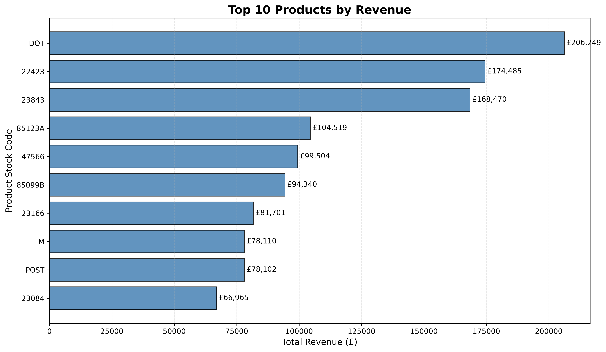
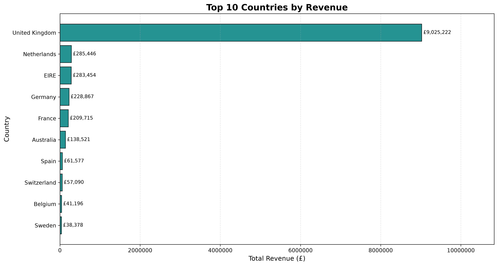
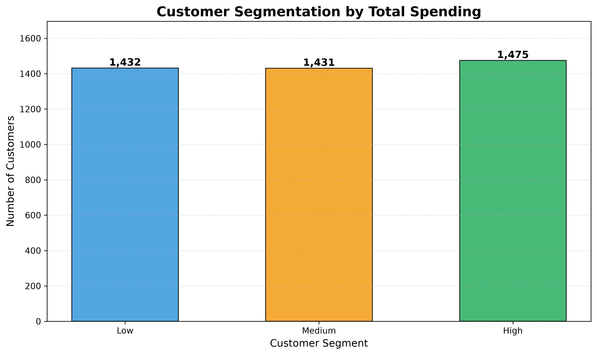
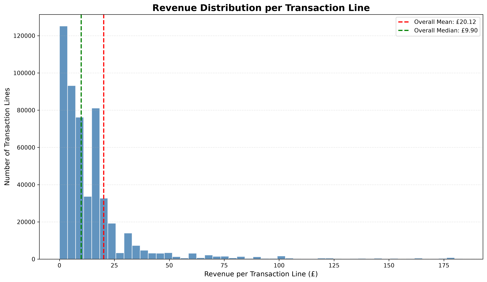
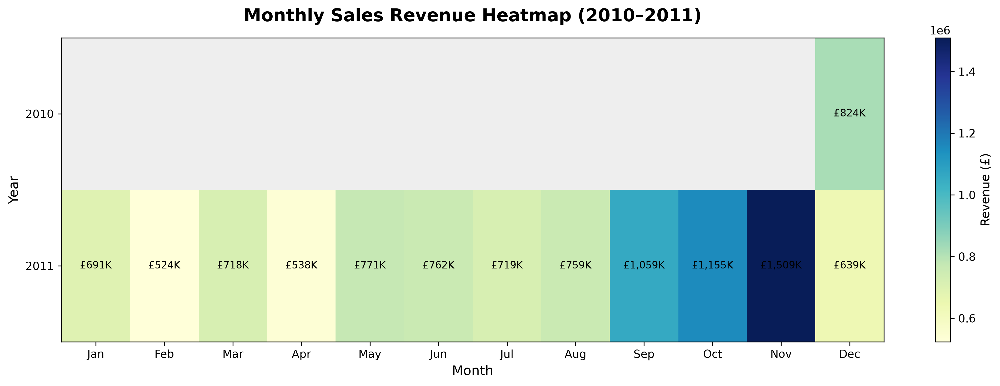
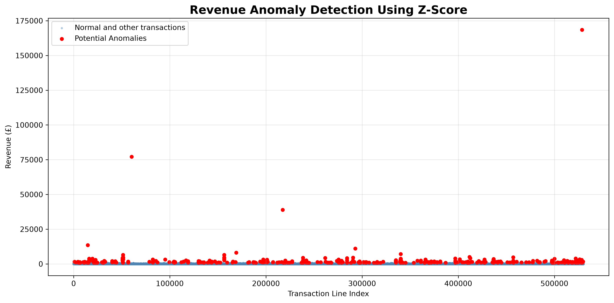
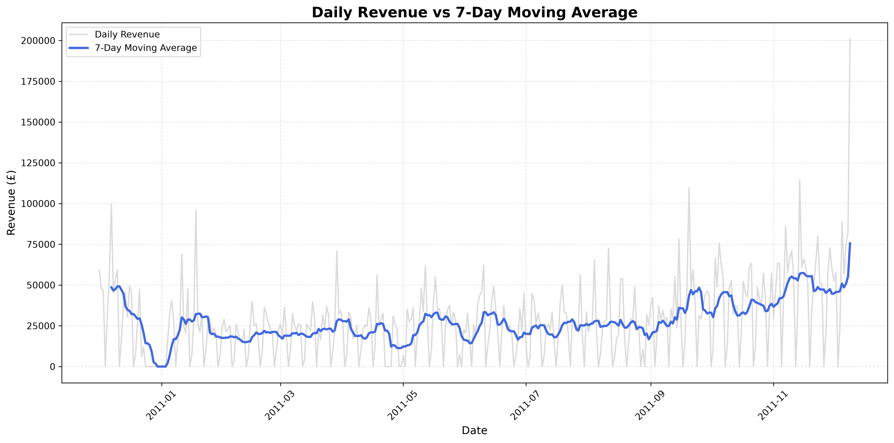
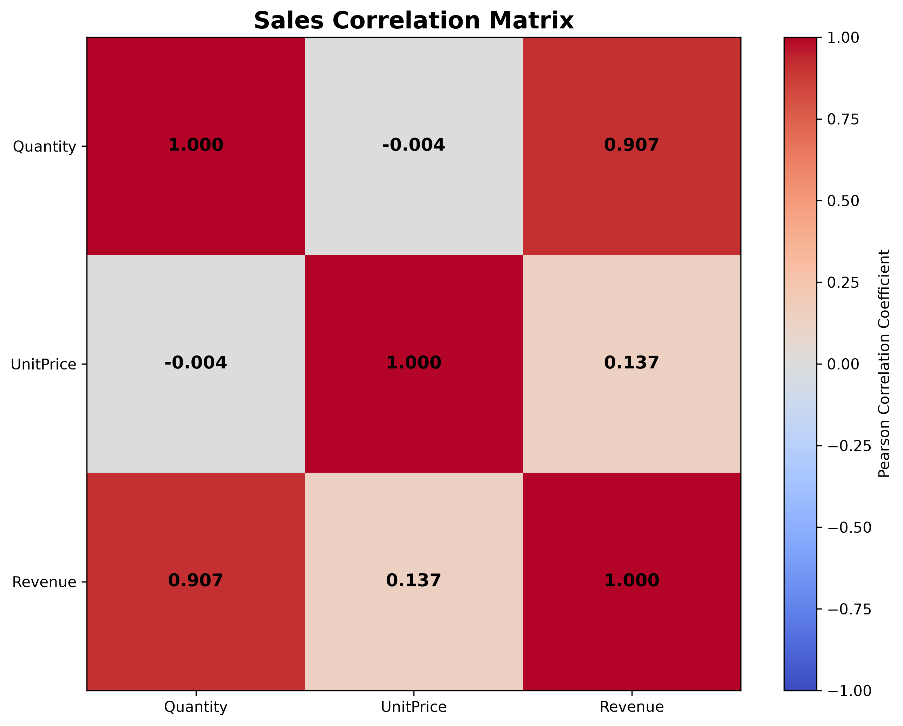
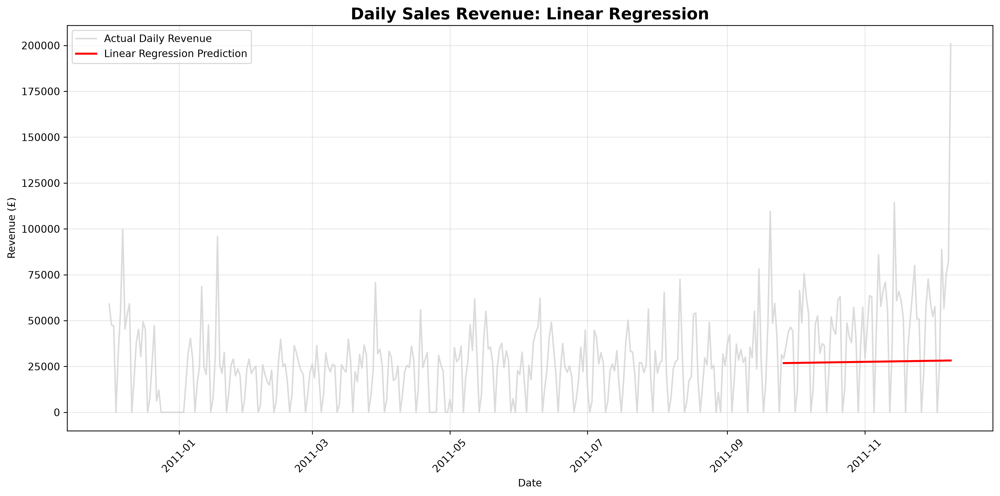

# Retail Sales Intelligence & Analytics

<p align="center">
  <strong>End-to-end retail analytics with NumPy, Python and Matplotlib</strong><br>
  Data cleaning · Sales intelligence · Customer segmentation · Statistical analysis
</p>

<p align="center">
  
  
  
  
  
</p>

An applied data analytics project built around the **[UCI Online Retail dataset](https://archive.ics.uci.edu/dataset/352/online+retail)**. The workflow transforms raw transaction records into sales and customer insights using **NumPy for numerical analysis**, **Pandas for Excel ingestion**, and **Matplotlib for visualization**. It also explores statistical anomaly detection, moving averages, correlation, and linear regression from scratch.

> **Scope:** This is a historical, exploratory analytics project—not a live business dashboard or a production forecasting system. Figures below are drawn from the reported notebook results; rerun the notebooks to reproduce them.

## At a glance

| Metric | Result |
|:--|--:|
| Raw transaction lines | **541,909** |
| Cleaned positive-sales lines | **530,104** |
| Excluded lines | **11,805** |
| Cleaned sales revenue | **£10,666,684.54** |
| Countries / territories recorded | **38** |
| Unique product codes in cleaned data | **3,922** |
| Customers with identifiable purchases | **4,338** |

## Contents

- [Business questions](#business-questions)
- [Dataset and methodology](#dataset-and-methodology)
- [Project structure](#project-structure)
- [Sales analysis](#sales-analysis)
- [Customer intelligence](#customer-intelligence)
- [Visualizations](#visualizations)
- [Advanced NumPy analytics](#advanced-numpy-analytics)
- [Key findings](#key-findings)
- [Installation and execution](#installation-and-execution)
- [Validation and limitations](#validation-and-limitations)
- [Future improvements](#future-improvements)

## Business questions

The analysis addresses questions that can inform retail operations:

- Which product codes drive the most revenue, and which sell the most units?
- How do monthly revenue and month-over-month changes evolve?
- Which markets contribute the greatest share of sales?
- How is spending distributed across identifiable customers?
- Which transactions appear statistically unusual?
- What patterns do moving averages, correlations, and a simple regression model reveal?

## Dataset and methodology

**Source:** [UCI Machine Learning Repository — Online Retail](https://archive.ics.uci.edu/dataset/352/online+retail)  
**Period:** 1 December 2010 to 9 December 2011  
**Original shape:** 541,909 rows × 8 columns  
**Currency:** GBP (£)

| Column | Meaning |
|:--|:--|
| `InvoiceNo` | Invoice identifier; cancellations are marked with a leading `C` |
| `StockCode` | Product or transaction-item code |
| `Description` | Item description |
| `Quantity` | Units on an invoice line |
| `InvoiceDate` | Transaction timestamp |
| `UnitPrice` | Price per unit |
| `CustomerID` | Customer identifier; may be missing |
| `Country` | Destination country or territory |

### Cleaning rules

The positive-sales dataset retains records satisfying all three conditions:

```python
valid_mask = (
    (quantity_arr > 0)
    & (unitprice_arr > 0)
    & ~np.char.startswith(invoice_arr, "C")
)
clean_df = df[valid_mask].copy()
```

| Cleaning outcome | Rows |
|:--|--:|
| Before cleaning | 541,909 |
| After cleaning | 530,104 |
| Excluded by these rules | 11,805 |

**Missing customer IDs do not automatically invalidate a sale.** Those rows remain in revenue analysis but are excluded from customer-specific calculations. In the cleaned dataset, **132,220** rows lack CustomerIDs, leaving **397,884** identifiable-customer transaction lines.

Processed, aligned arrays are saved with `np.savez()` as `data/processed/cleaned_sales.npz` and read by downstream notebooks using `np.load()`.

## Project structure

```text
retail-sales-intelligence/
├── data/
│   ├── raw/
│   │   └── Online Retail.xlsx       # Download separately
│   └── processed/
│       └── cleaned_sales.npz        # Generated by Notebook 02
├── notebooks/
│   ├── 01_data_exploration.ipynb
│   ├── 02_data_cleaning.ipynb
│   ├── 03_sales_analysis.ipynb
│   ├── 04_customer_analysis.ipynb
│   ├── 05_visualization.ipynb
│   └── 06_advanced_numpy.ipynb
├── outputs/
│   ├── charts/
│   └── reports/
│       └── business_insights.md     # If maintained locally
├── requirements.txt
├── .gitignore
└── README.md
```

| Notebook | Responsibility |
|:--|:--|
| `01_data_exploration` | Inspect schema, summary statistics and quality issues |
| `02_data_cleaning` | Create consistent valid-sales masks; export `.npz` arrays |
| `03_sales_analysis` | Revenue, quantities, product rankings, monthly trends and markets |
| `04_customer_analysis` | Customer spending, orders, AOV and segmentation |
| `05_visualization` | Sales, product, market and customer charts |
| `06_advanced_numpy` | Z-scores, smoothing, percentiles, correlation and regression |

## Sales analysis

NumPy vectorization calculates line-level revenue as `Quantity × UnitPrice`, followed by aggregations and rankings.

| Measure | Result |
|:--|--:|
| Revenue | **£10,666,684.54** |
| Units sold | **5,588,376** |
| Mean revenue per transaction line | **£20.12** |
| Distinct product codes | **3,922** |

### Top 10 product codes by revenue

| Rank | StockCode | Revenue |
|---:|:--|--:|
| 1 | DOT | £206,248.77 |
| 2 | 22423 | £174,484.74 |
| 3 | 23843 | £168,469.60 |
| 4 | 85123A | £104,518.80 |
| 5 | 47566 | £99,504.33 |
| 6 | 85099B | £94,340.05 |
| 7 | 23166 | £81,700.92 |
| 8 | M | £78,110.27 |
| 9 | POST | £78,101.88 |
| 10 | 23084 | £66,964.99 |

Together, these codes account for **£1,152,444.35 (10.80%)** of cleaned revenue. **Caution:** Some stock codes (such as shipping or manual adjustments) may represent non-merchandise items; this is a ranking of recorded *codes*, not necessarily ten physical products.

### Top 10 product codes by units sold

| Rank | StockCode | Units |
|---:|:--|--:|
| 1 | 23843 | 80,995 |
| 2 | 23166 | 78,033 |
| 3 | 22197 | 56,921 |
| 4 | 84077 | 55,047 |
| 5 | 85099B | 48,474 |
| 6 | 85123A | 37,660 |
| 7 | 84879 | 36,461 |
| 8 | 21212 | 36,419 |
| 9 | 23084 | 30,788 |
| 10 | 22492 | 26,633 |

### Monthly revenue

| Month | Revenue | Month | Revenue |
|:--|--:|:--|--:|
| Dec 2010 | £823,746.14 | Jan 2011 | £691,364.56 |
| Feb 2011 | £523,631.89 | Mar 2011 | £717,639.36 |
| Apr 2011 | £537,808.62 | May 2011 | £770,536.02 |
| Jun 2011 | £761,739.90 | Jul 2011 | £719,221.19 |
| Aug 2011 | £759,138.38 | Sep 2011 | £1,058,590.17 |
| Oct 2011 | £1,154,979.30 | Nov 2011 | £1,509,496.33 |
| Dec 2011 | £638,792.68 | | |

**Highest recorded monthly revenue:** November 2011, **£1,509,496.33**.  
**Lowest recorded monthly revenue:** February 2011, **£523,631.89**.

Month-over-month growth was calculated using consecutive monthly totals. Results involving December 2010 and December 2011 require special care because those months are incomplete in the dataset; in particular, the sharp November-to-December 2011 drop is **not** evidence of a full-month collapse.

### Revenue by country

| Rank | Market | Revenue |
|---:|:--|--:|
| 1 | United Kingdom | £9,025,222.08 |
| 2 | Netherlands | £285,446.34 |
| 3 | EIRE (Ireland) | £283,453.96 |
| 4 | Germany | £228,867.14 |
| 5 | France | £209,715.11 |
| 6 | Australia | £138,521.31 |
| 7 | Spain | £61,577.11 |
| 8 | Switzerland | £57,089.90 |
| 9 | Belgium | £41,196.34 |
| 10 | Sweden | £38,378.33 |

The UK contributed **84.61%** of cleaned revenue. Country-wise sums reconcile to the overall revenue total.

## Customer intelligence

Customer-specific work uses only rows with a valid `CustomerID`; it **does not** remove anonymous sales from the broader revenue dataset.

| Metric | Result |
|:--|--:|
| Identifiable customer transaction lines | 397,884 |
| Distinct customers | 4,338 |
| Distinct invoices in customer subset | 18,532 |
| Revenue associated with identified customers | £8,911,407.90 |
| Average order value (identified customers) | £480.87 |

### Highest-spending customers

| Rank | Customer ID | Spending |
|---:|---:|--:|
| 1 | 14646 | £280,206.02 |
| 2 | 18102 | £259,657.30 |
| 3 | 17450 | £194,550.79 |
| 4 | 16446 | £168,472.50 |
| 5 | 14911 | £143,825.06 |
| 6 | 12415 | £124,914.53 |
| 7 | 14156 | £117,379.63 |
| 8 | 17511 | £91,062.38 |
| 9 | 16029 | £81,024.84 |
| 10 | 12346 | £77,183.60 |

### Segmentation and spending distribution

Customers are assigned to **Low**, **Medium** and **High** relative-spending groups using the **33rd and 66th percentile** thresholds.

| Segment | Customers |
|:--|--:|
| Low | 1,432 |
| Medium | 1,431 |
| High | 1,475 |
| **Total** | **4,338** |

| Customer spending percentile | Value |
|:--|--:|
| 25th | £307.41 |
| 50th (median) | £674.48 |
| 75th | £1,661.74 |
| 90th | £3,646.53 |
| 95th | £5,841.84 |
| 99th | £19,881.00 |

At or above the 90th-percentile threshold, **434 customers** contributed **£5,469,382.46 (61.38%)** of identified-customer revenue. The percentile boundary may include ties.

## Visualizations

The images below refer to charts generated by the notebooks. Ensure `outputs/charts/` and these filenames are committed to the repository.

### Top product codes by revenue



### Country-wise revenue



### Customer segmentation



### Revenue distribution



### Monthly sales heatmap



### Anomaly detection



### Seven-day moving average



### Sales correlation



### Linear regression



> A monthly revenue **line chart** was also developed in the visualization notebook; add its image here after saving it to `outputs/charts/` with a stable filename.

## Advanced NumPy analytics

| Technique | NumPy tools | Intended insight |
|:--|:--|:--|
| Z-score anomaly detection | `np.mean`, `np.std`, `np.abs`, `np.where` | Identify unusually large invoice-line revenue values |
| Seven-day moving average | `np.convolve` | Smooth daily revenue fluctuations |
| Customer percentiles | `np.percentile`, `np.bincount` | Quantify concentration of spending |
| Correlation matrix | `np.corrcoef` | Examine linear relationships between quantity, unit price and revenue |
| Least-squares regression | `np.linalg.lstsq` | Fit a simple daily-revenue trend for educational evaluation |

### Reported analysis results

- **Z-score analysis:** mean revenue **£20.12**, standard deviation **£270.36**, and **535** potential anomalies (**0.10%** of cleaned lines).
- **Moving average:** **374** calendar days, **305** dates with recorded transactions, and **368** seven-day windows. The first window yielded **£48,553.78**, matching the direct seven-day mean within floating-point precision.
- **Pearson correlations:** quantity–revenue **0.9073**; unit price–revenue **0.1374**; quantity–unit price **−0.0038**. Revenue is calculated from quantity and unit price, so these relationships are not evidence of independent causal effects.
- **Linear regression evaluation:** reported test-set **MAE £28,140.85** and **RMSE £35,995.95**. These large errors underscore that a straight-line time trend is a limited baseline for fluctuating retail sales.

The notebooks also extrapolate revenue for seven historical calendar dates after the dataset ends. Those numbers are **illustrative outputs of the fitted model, not validated forecasts**; forecast coefficients and displayed predictions should be reconciled in the notebook before specific forecast figures are published here.

## Key findings

1. **Market concentration:** The UK contributes **84.61%** of revenue. This concentration is relevant to market diversification and retention discussions, but does not by itself prescribe a strategy.
2. **Product mix:** Rankings differ depending on whether performance is measured by revenue or units; stock-code definitions must be checked before inventory decisions.
3. **Monthly variation:** November 2011 is the highest observed revenue month. Partial first/last months should not be interpreted as full-period performance.
4. **Customer concentration:** Customers at or above the 90th spending percentile contribute **61.38%** of revenue associated with identifiable customers.
5. **Data quality:** **11,805** rows were excluded for positive-sales analysis. A full financial view would separately account for returns, refunds and adjustments.

These are descriptive findings. Any marketing, pricing, stock or retention initiative would need further validation against costs, margins and current operational data.

## Installation and execution

### Requirements

- Python **3.12+** (use a version supported by the pinned packages in `requirements.txt`)
- Git
- Jupyter Notebook or VS Code with Python/Jupyter extensions

### 1. Clone the repository

```bash
git clone <YOUR_REPOSITORY_URL>
cd retail-sales-intelligence
```

Replace the placeholder with your real GitHub repository URL, and use the folder name created by the clone command.

### 2. Create and activate a virtual environment

```bash
python3 -m venv .venv
source .venv/bin/activate
python -m pip install -r requirements.txt
```

### 3. Download the dataset

Download the Excel file from the [official UCI source](https://archive.ics.uci.edu/dataset/352/online+retail), then save it as:

```text
data/raw/Online Retail.xlsx
```

Create `data/raw/`, `data/processed/` and `outputs/charts/` if absent. The raw and processed datasets can remain excluded from Git tracking.

### 4. Run the notebooks in order

| Run order | Notebook | Output or dependency |
|---:|:--|:--|
| 1 | `01_data_exploration.ipynb` | Explore raw Excel data |
| 2 | `02_data_cleaning.ipynb` | Create `data/processed/cleaned_sales.npz` |
| 3 | `03_sales_analysis.ipynb` | Calculate sales metrics |
| 4 | `04_customer_analysis.ipynb` | Calculate customer metrics |
| 5 | `05_visualization.ipynb` | Generate charts |
| 6 | `06_advanced_numpy.ipynb` | Run advanced statistical analyses |

In VS Code, select your `.venv` kernel and run each notebook from the top. **Path note:** These notebooks use paths such as `../data/...`, which assume the working directory is `notebooks/`. If your Jupyter kernel starts at the repository root, adapt those paths or standardize path handling before running.

## Validation and limitations

### Checks reported by the notebooks

- Monthly revenue sums reconcile to overall revenue.
- Country-wise revenue totals reconcile to overall revenue.
- Customer spending and segment counts pass aggregate consistency checks.
- Seven-day convolution average matches a directly calculated seven-day mean.
- Heatmap revenue sums reconcile to cleaned revenue.
- The correlation matrix has the expected shape and symmetry.

These are **not a formal automated test suite**; a fresh-kernel run of every notebook is recommended before sharing the repository.

### Known limitations

- **Historical data:** Sales patterns from 2010–2011 should not be generalized to the current retail market.
- **Incomplete months:** December 2010 and December 2011 are partial periods.
- **Returns and special items:** Positive-sales filtering excludes cancellations and nonpositive lines; some `StockCode` values may represent postage or manual charges.
- **Missing IDs:** Customer analysis excludes rows without identifiable CustomerIDs.
- **Revenue ≠ profit:** Product costs, shipping, taxes and other expenses are not modeled.
- **Statistical caveats:** High skew can affect z-score detection; correlation is not causation.
- **Calendar assumption:** Dates with no recorded sales are treated as zero-revenue days in the moving-average analysis, which may not always mean the store was operating with no sales.
- **Forecasting:** The linear regression baseline does not account for seasonality, holidays, holidays/closures, inventory or changing business conditions.

## Future improvements

- Interactive Streamlit dashboard and filtering
- Product description and transaction-code normalization
- Return/refund-aware financial reporting
- RFM segmentation and repeat-customer analysis
- SQL-backed analytics workflow and automated checks
- Better time-series baselines and forecasting evaluation

## Author

**Farman Ullah Khan**  
BS Software Engineering · Aspiring AI Engineer  
[Portfolio](https://farmanullah-portfolio.vercel.app)

**Dataset credit:** [UCI Machine Learning Repository — Online Retail](https://archive.ics.uci.edu/dataset/352/online+retail)
